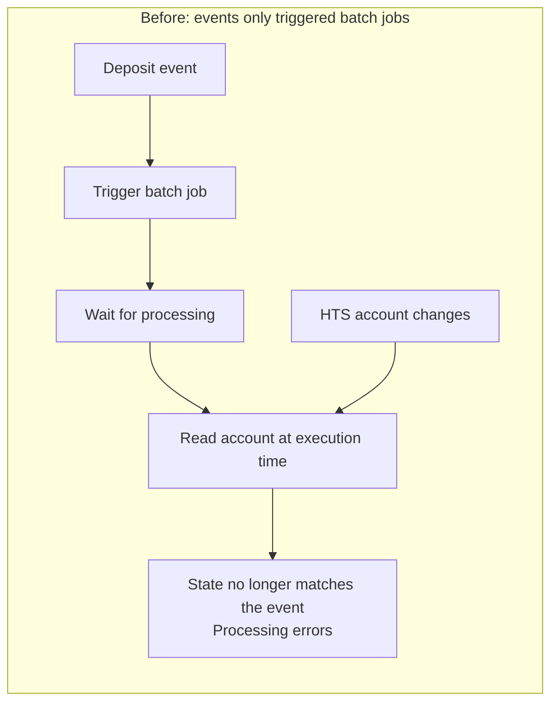
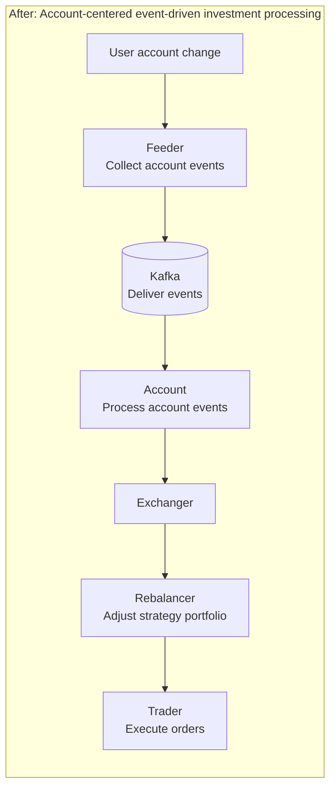

# Account Event-Driven Robo-Advisor Investment Platform

As the project lead and a core individual contributor for DNDN, I worked with a team of approximately eight engineers to rebuild an error-prone batch investment system as an **account event-driven robo-advisor platform**.

The legacy system triggered batch jobs when deposit events arrived, but investments were processed later using the account state available at batch execution time. If additional deposits, withdrawals, or asset changes occurred through the HTS in the meantime, the original event assumptions no longer matched the actual account state. This timing gap repeatedly caused processing and operational errors.

To solve this, I defined **Account as the central investment domain** and designed an architecture that consumes external account changes as Kafka events, then drives portfolio construction, rebalancing, and order execution according to each user's risk profile and selected strategy.

As PL, I led the problem definition, technical direction, service boundaries, and phased migration strategy. At the same time, as a core IC, I directly owned and implemented the **Account, Exchanger, Rebalancer, and Trader services**, as well as **shared modules for consistent event processing and service development**. This established a foundation that the entire team could build on and extend, and I remained responsible through the production rollout.

## Structural Problem Solved by the New System

## Role and Contributions

- Led the architecture, implementation, and production rollout of a new system replacing the legacy batch architecture as PL for a team of approximately eight engineers
- Identified the account-state inconsistency inherent in delayed batch processing and designed the event-driven architecture
- Defined the Account-centered investment domain and service responsibilities
- Owned and implemented Account, Exchanger, Rebalancer, and Trader as a core IC
- Designed and implemented shared modules to improve consistency and productivity across services
- Built the flow from account events through strategy-based portfolio construction, rebalancing, and order execution
- Implemented the trading system and investment-advisory approval system
- Validated the domain quickly, then migrated to MSA using service boundaries designed from the outset
