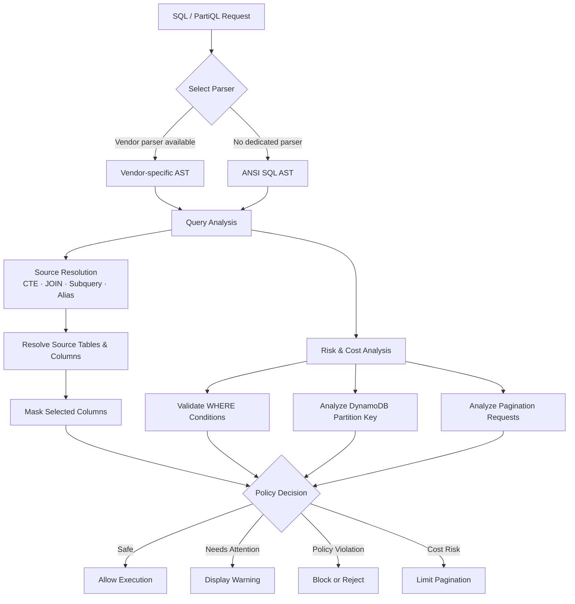
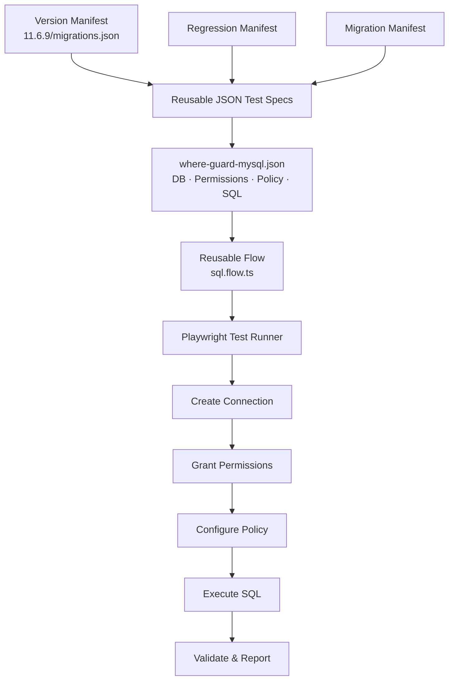

# AST-Based Query Analysis and Data Access Control

I primarily own SQL and NoSQL query analysis and policy enforcement features in QueryPie's data access control product. I did not design the original system from scratch; as the primary engineer for this area today, I understand and extend the existing architecture to address production requirements and new database-specific behavior.

To provide consistent access control across database vendors, I use ANSI SQL parsing as a common analysis layer. Even when a vendor-specific parser is unavailable, the system can trace data sources across CTEs, JOINs, subqueries, and aliases, then apply masking policies to user-defined tables and columns.

The system also evaluates potential large reads and cost risks using the AST and database-specific execution characteristics. It detects queries with no WHERE clause or ineffective filters such as `1=1`, as well as DynamoDB PartiQL statements that may perform a Scan because they lack Partition Key equality. Policies can block or reject execution, display a warning, or limit pagination requests to prevent unintended AWS costs.

## From Query Analysis to Policy Enforcement

## Core Contributions

- Implemented common query analysis using ANSI SQL ASTs
- Resolved source tables and columns across CTEs, JOINs, subqueries, and aliases
- Applied data masking policies to columns selected by users
- Detected potentially large reads with missing or ineffective filters
- Analyzed DynamoDB PartiQL Partition Key conditions to identify potential Scans
- Implemented policy-based blocking, rejection, warnings, and pagination limits
- Produced up to five alternatives for a single requirement, balancing security, cost, usability, and deadlines with stakeholders
- Proactively identified and developed capabilities needed for reliable product operation, even without explicit customer requests

## Declarative E2E Test Automation Platform

Alongside feature delivery, I proactively built a declarative E2E test platform with Playwright Test to make repetitive access-control scenarios reusable. Common execution steps—creating database connections, granting permissions, configuring policies, executing SQL, and validating results—live in reusable flows such as `sql.flow.ts`. Each test's database type, permissions, policies, and SQL statements are separated into human-readable JSON specifications.

Individual JSON test cases can be composed into multiple suites, while version, regression, and migration manifests only declare which test cases to run. For example, referencing `where-guard-mysql.json` from `11.6.9/migrations.json` includes that reusable test asset in the 11.6.9 migration suite, while allowing the same case to be reused in other versions and regression suites.

By separating execution logic from test data, developers and QA can validate combinations of databases and policies by changing JSON rather than repeatedly writing TypeScript. AI can also author constrained specifications instead of generating arbitrary test code, while the validated flows execute deterministically. Tests created during feature development become immediately reusable by QA across version, migration, and regression suites, reducing test-authoring and execution costs while accelerating cross-team validation.

## Delivery Ownership

I have repeatedly owned critical features tied directly to major customer contracts and delivery schedules. I initially focused on finding missing requirements, edge cases, and unassigned work in feature tickets before they became delivery gaps. My scope has since expanded to work allocation and sprint progress management. While implementing core features, I also review the team's broader work and progress to help ensure the project is delivered completely and on schedule.
