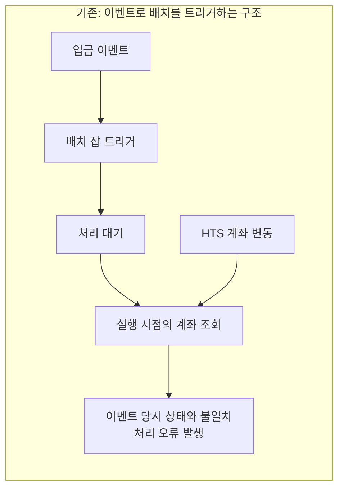
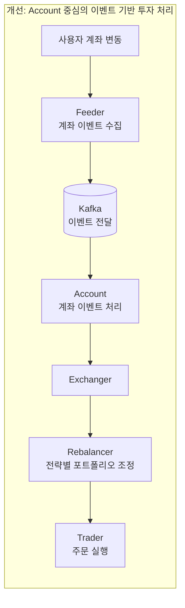

# 계좌 이벤트 기반 로보어드바이저 투자 플랫폼

DNDN 프로젝트의 PL이자 핵심 IC로서 약 8명의 개발자와 함께, 오류가 빈번하던 배치 기반 투자 시스템을 **계좌 이벤트 기반의 로보어드바이저 플랫폼**으로 재구축했습니다.

기존 시스템은 입금 이벤트로 배치 잡을 트리거했지만, 실제 투자는 지연된 배치 실행 시점의 계좌 정보를 기준으로 처리했습니다. 그사이 HTS에서 추가 입출금이나 자산 변동이 발생하면 이벤트 당시의 전제와 실제 계좌 상태가 달라졌고, 처리 순서와 시점에 따라 반복적인 운영 오류가 발생했습니다.

이를 해결하기 위해 **Account를 투자 처리의 중심 도메인으로 정의**하고, 외부에서 발생하는 계좌 변동을 Kafka 이벤트로 수집하여 투자 성향과 선택 전략에 따른 포트폴리오 구성, 리밸런싱, 주문 실행으로 이어지는 아키텍처를 설계했습니다.

PL로서 문제 정의, 기술 방향, 서비스 경계와 단계별 전환 전략을 주도했습니다. 동시에 IC로서 **Account, Exchanger, Rebalancer, Trader 등 핵심 서비스를 직접 담당**하고, 여러 서비스가 일관된 방식으로 동작할 수 있도록 **이벤트 처리와 서비스 개발에 필요한 공통 모듈을 설계·구현**했습니다. 이를 통해 개별 기능 구현을 넘어 팀 전체가 안정적으로 개발하고 확장할 수 있는 기반을 구축했으며, 프로덕션 전환까지 책임졌습니다.

## 신규 시스템 구축으로 해결한 구조적 문제

## 역할과 기여

- 약 8명 규모 프로젝트의 PL로서 기존 배치 구조를 대체하는 신규 시스템 구축과 프로덕션 전환 주도
- 배치 처리의 계좌 상태 불일치 문제를 정의하고 이벤트 기반 아키텍처 설계
- Account 중심의 투자 도메인과 서비스 책임·경계 설계
- 핵심 IC로서 Account, Exchanger, Rebalancer, Trader 구현 담당
- 여러 서비스에서 재사용하는 공통 모듈을 설계·구현하여 개발 일관성과 생산성 확보
- 투자 성향과 전략에 따른 포트폴리오 구성, 리밸런싱 및 주문 실행 흐름 구축
- 트레이딩 시스템 및 자문(승인) 시스템 구현
- 빠른 도메인 검증 후, 사전에 설계한 서비스 경계를 기반으로 MSA 전환
