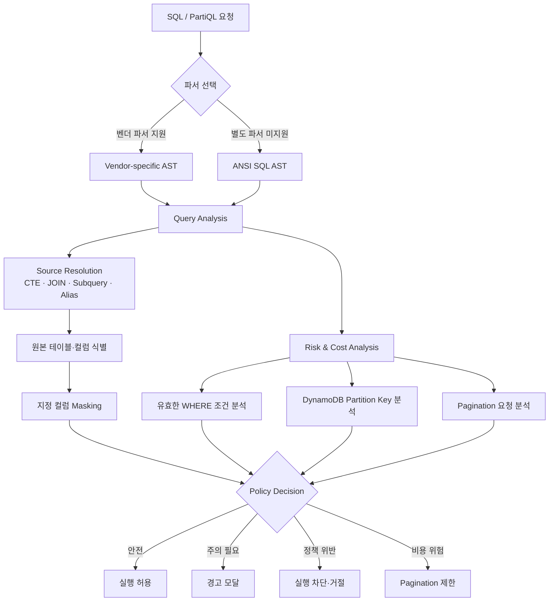
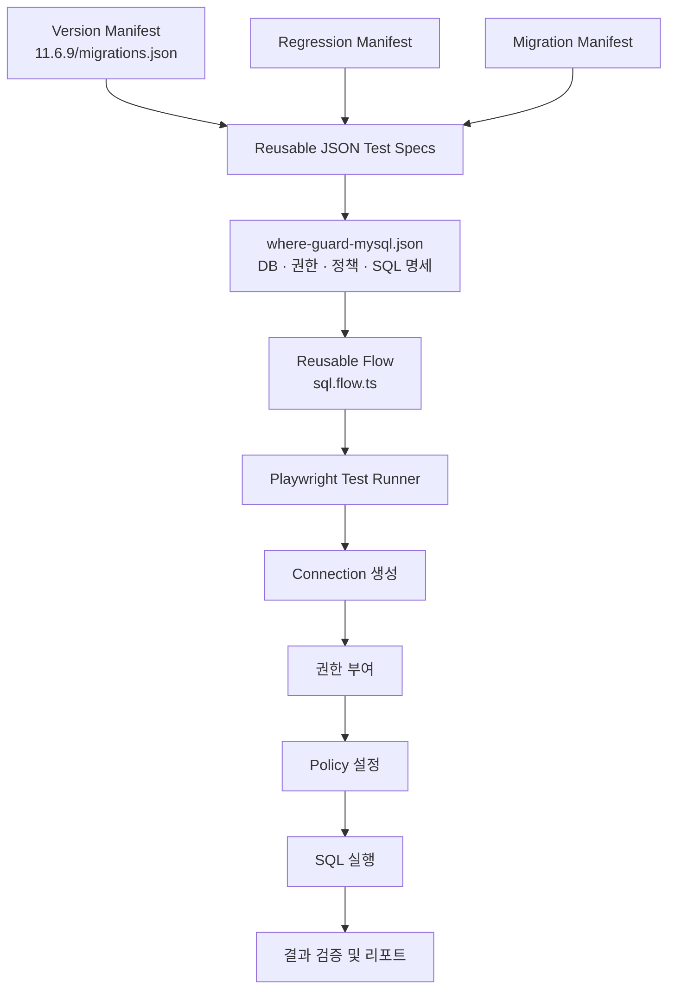

# AST 기반 쿼리 분석 및 데이터 접근제어

QueryPie의 데이터 접근제어 제품에서 SQL·NoSQL 쿼리 분석과 정책 적용 기능을 주로 담당하고 있습니다. 기존 시스템을 처음부터 설계한 것은 아니지만, 현재는 쿼리 분석 영역의 주 담당자로서 기존 구조를 이해하고 확장하며 프로덕션 요구사항과 신규 데이터베이스 특성에 대응하고 있습니다.

다양한 데이터베이스 벤더에 일관된 접근제어 기능을 제공하기 위해 ANSI SQL 기반의 공통 구문 분석을 활용했습니다. 벤더별 전용 파서가 없는 경우에도 CTE, JOIN, Subquery, Alias 등으로 구성된 쿼리의 데이터 소스를 추적하고, 사용자가 지정한 테이블과 컬럼에 마스킹 정책을 적용할 수 있도록 구현했습니다.

또한 AST와 데이터베이스별 실행 특성을 바탕으로 잠재적인 대량 조회와 비용 위험을 판별합니다. WHERE 절이 없거나 `1=1`처럼 실질적인 필터링 효과가 없는 조건, DynamoDB PartiQL에서 Partition Key equality가 없어 Scan으로 실행될 수 있는 구문 등을 탐지하고, 정책에 따라 실행 차단·거절 또는 경고를 제공합니다. Pagination 최대 요청 횟수 제한과 같은 보호 장치도 제공해 의도하지 않은 AWS 비용 증가를 방지합니다.

## 쿼리 분석에서 정책 적용까지

## 핵심 기여

- ANSI SQL AST를 활용한 공통 쿼리 분석 기능 구현
- CTE, JOIN, Subquery, Alias를 해석해 원본 테이블·컬럼 추적
- 사용자가 지정한 컬럼에 데이터 마스킹 정책 적용
- 필터가 없거나 무효한 조건을 가진 잠재적 대량 조회 쿼리 탐지
- DynamoDB PartiQL의 Partition Key 조건을 분석해 Scan 가능성 판별
- 정책에 따른 쿼리 차단·거절·경고와 Pagination 제한 기능 구현
- 보안·비용·사용성·일정을 함께 고려해 하나의 요구사항에 최대 5개의 대안을 도출하고 유관 부서와 조율
- 고객이 명시적으로 요청하지 않은 기능도 제품 운영에 필요하면 선제적으로 발굴·개발

## 선언형 E2E 테스트 자동화 플랫폼

기능 개발과 병행해 반복적인 접근제어 테스트를 재사용할 수 있는 Playwright Test 기반의 선언형 E2E 테스트 플랫폼을 선제적으로 구축했습니다. 데이터베이스 연결 생성, 권한 부여, 정책 설정, SQL 실행과 결과 검증 같은 공통 실행 절차는 `sql.flow.ts`와 같은 재사용 가능한 Flow로 구현하고, 개별 테스트의 데이터베이스 종류·권한·정책·실행할 SQL은 사람이 쉽게 읽고 수정할 수 있는 JSON 명세로 분리했습니다.

개별 JSON 테스트 케이스는 여러 Suite에서 재사용할 수 있으며, 버전·Regression·Migration Manifest는 실행할 테스트 케이스의 조합만 선언합니다. 예를 들어 `11.6.9/migrations.json`에서 `where-guard-mysql.json`을 참조하면 동일한 테스트 자산을 11.6.9 마이그레이션 검증에 포함하고, 다른 버전이나 회귀 테스트에서도 그대로 재사용할 수 있습니다.

실행 로직과 테스트 데이터를 분리함으로써 개발자와 QA는 TypeScript 코드를 반복해서 작성하지 않고 JSON만 교체해 다양한 데이터베이스와 정책 조합을 검증할 수 있게 되었습니다. AI 역시 자유롭게 테스트 코드를 생성하는 대신 제한된 JSON 명세만 작성하고, 실제 실행은 검증된 Flow가 결정적으로 수행하도록 구성했습니다. 개발 중 작성한 테스트를 QA가 즉시 버전·마이그레이션·회귀 검증에 재사용하면서 테스트 작성과 실행 비용을 줄이고 팀 간 검증 속도를 높였습니다.

## 딜리버리 오너십

주요 고객 계약과 납품 일정에 직결된 핵심 기능을 반복적으로 담당해 왔습니다. 초기에는 기능 티켓의 요구사항과 예외 상황, 담당 누락 여부를 점검해 개발 과정의 공백을 선제적으로 방지했으며, 현재는 업무 배분과 스프린트 진행 관리까지 책임 범위를 확대했습니다. 핵심 기능을 직접 구현하면서도 다른 개발자의 업무와 전체 진행 상황을 함께 살펴 프로젝트가 일정에 맞게 완결되도록 기여하고 있습니다.
